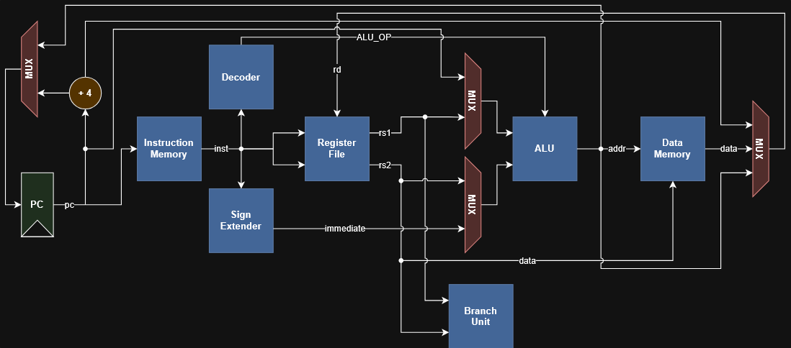

# Single-Cycle RISC-V Processor

A 32-bit RISC-V (RV32I) processor in Verilog where every instruction finishes
in one clock cycle. I built it to understand what actually executes an
instruction: the datapath, control unit, ALU, register file, decoder and
memory interface, and to check that arithmetic, memory, branch and jump
instructions all behave.



## What it can run

- Arithmetic and logic: `add sub and or xor sll srl sra slt sltu`, the
  immediate versions (`addi andi ori xori slti sltiu slli srli srai`), `lui`, `auipc`
- Memory: `lw lh lhu lb lbu`, `sw sh sb`
- Branches: `beq bne blt bge bltu bgeu`
- Jumps: `jal`, `jalr`

Not included: `fence`, `ecall`/`ebreak`, CSRs, interrupts, multiply/divide, and
misaligned memory accesses.

## Files

| File | What it does |
|------|--------------|
| `riscv_top.v` | Top level. PC, next-PC selection, write-back mux, wiring. |
| `control_unit.v` | Turns the opcode into control signals. |
| `alu_dec.v` | Picks the ALU operation from `alu_op`, `funct3` and `funct7`. |
| `alu.v` | The ALU (10 operations plus a zero flag). |
| `branch_unit.v` | Decides if a branch is taken (signed and unsigned compares). |
| `imm_gen.v` | Pulls the immediate out of I, S, B, U and J instructions. |
| `reg_file.v` | 32 registers, `x0` always reads 0. |
| `inst_mem.v` | Instruction memory, filled from a `.hex` file. |
| `data_mem.v` | Data memory with byte, half-word and word access (1 KiB). |
| `tb_*.v` | Testbenches, one per module plus two for the whole processor. |
| `tests/test_program.s` | The long assembly program used by the system test. |
| `tests/demo.s` | A short program for demonstrations. |
| `tools/rvasm.py` | A small assembler that turns `.s` files into `.hex`. |

## How to run it

You need Icarus Verilog (version 11 or newer, it comes with GTKWave) and
Python 3. On Windows, just double-click one of these:

| File | What happens |
|------|--------------|
| `run_tests.bat` | Runs the nine module and system testbenches and says if they all passed. |
| `run_demo.bat` | Runs the demo program and prints each instruction as it executes. |
| `run_demo_wave.bat` | Same as above, then opens the waveform in GTKWave. |

The `.bat` files are only there so you don't have to deal with PowerShell's
script policy. If you prefer a terminal, `powershell -ExecutionPolicy Bypass
-File run_tests.ps1` does the same thing. The scripts look for Icarus
in `C:\iverilog12\bin` if it is not on your PATH.

To run a single testbench by hand, compile and then simulate. Compiling prints
nothing when it works:

```
iverilog -g2005 -o build\tb_alu.vvp tb_alu.v alu.v
vvp build\tb_alu.vvp
```

Add `-DDUMP_VCD` to the compile line if you also want a waveform file.

## The demo

`tests/demo.s` is a short program, one idea per line. Running it prints this:

```
cycle    | PC      | instruction          | effect
---------+---------+----------------------+------------------------------
cycle  0 | PC=0x00 | addi x1,x0,10        | x1 <= 10
cycle  1 | PC=0x04 | addi x2,x0,3         | x2 <= 3
cycle  2 | PC=0x08 | add x3,x1,x2         | x3 <= 13
cycle  3 | PC=0x0c | sub x4,x1,x2         | x4 <= 7
cycle  4 | PC=0x10 | and x5,x1,x2         | x5 <= 2
cycle  5 | PC=0x14 | or x6,x1,x2          | x6 <= 11
cycle  6 | PC=0x18 | sll x7,x1,x2         | x7 <= 80
cycle  7 | PC=0x1c | sw x3,0(x0)          | mem[0] <= 13
cycle  8 | PC=0x20 | sw x4,4(x0)          | mem[4] <= 7
cycle  9 | PC=0x24 | lw x8,0(x0)          | x8 <= mem[0] = 13
cycle 10 | PC=0x28 | lw x9,4(x0)          | x9 <= mem[4] = 7
cycle 11 | PC=0x2c | beq x8,x3,8          | branch TAKEN -> PC=0x34
cycle 12 | PC=0x34 | addi x10,x0,1        | x10 <= 1
cycle 13 | PC=0x38 | bne x8,x9,8          | branch TAKEN -> PC=0x40
cycle 14 | PC=0x40 | addi x11,x0,2        | x11 <= 2
cycle 15 | PC=0x44 | jal x12,8            | jump, x12 <= 0x48 (return addr)
cycle 16 | PC=0x4c | addi x13,x0,3        | x13 <= 3
cycle 17 | PC=0x50 | auipc x14,0x0        | x14 <= 80
cycle 18 | PC=0x54 | jalr x15,12(x14)     | jump, x15 <= 0x58 (return addr)
cycle 19 | PC=0x5c | addi x16,x0,4        | x16 <= 4
cycle 20 | PC=0x60 | jal x0,0             | jump -> PC=0x60 (stop loop)
DEMO PASSED: all 16 register values match
```

Look at the PC column around the branches. After `beq` at `0x2c` the PC goes
to `0x34`, so the `addi x10,x0,99` sitting at `0x30` is never executed. The
same thing happens after `bne`, `jal` and `jalr`. Each of those skipped
instructions would write 99 into a register, so if `x10`, `x11`, `x13` or
`x16` ended up as 99 we would know the jump was wrong. The last instruction
jumps to itself, which is how the program stops.

## Reading the waveform

`run_demo_wave.bat` opens GTKWave with the signals below already added.
Maximise the window and zoom in with Ctrl and the scroll wheel, otherwise the
instruction text is squeezed and unreadable. The clock period is 10 ns and one
instruction finishes per clock. Registers update on the rising edge, so a
register shows its new value one clock after the instruction appears in `asm`.

| Signal | What it is |
|--------|-----------|
| `clk` | The clock. Each rising edge finishes one instruction. |
| `asm` | The instruction being executed, as text. The testbench decodes it just for display. |
| `pc` | Address of the current instruction (hex). Goes up by 4, or jumps on a taken branch, `jal` or `jalr`. |
| `branch_taken` | High when a branch instruction is running and its condition is true. Shows up twice in the demo, for `beq` and `bne`. |
| `x1` | 10, set by the first `addi`. |
| `x2` | 3, set by the second `addi`. Also used as the shift amount. |
| `x3` | `x1 + x2` = 13. This is the value stored to memory address 0. |
| `x4` | `x1 - x2` = 7. Stored to memory address 4. |
| `x5` | `x1 AND x2` = 2. |
| `x6` | `x1 OR x2` = 11. |
| `x7` | `x1` shifted left by `x2` = 80. |
| `x8` | Loaded back from address 0, so it should equal `x3` (13). |
| `x9` | Loaded back from address 4, so it should equal `x4` (7). |
| `x10` | Ends at 1 if `beq` skipped the next instruction. 99 means it didn't. |
| `x11` | Ends at 2 if `bne` skipped the next instruction. |
| `x12` | Return address that `jal` saved (72, which is `0x48`). |
| `x13` | Ends at 3 if `jal` skipped the next instruction. |
| `x14` | Result of `auipc`: the address of that instruction (80, `0x50`). |
| `x15` | Return address that `jalr` saved (88, `0x58`). |
| `x16` | Ends at 4 if `jalr` skipped the next instruction. |

Final values, in order from `x1` to `x16`:
10, 3, 13, 7, 2, 11, 80, 13, 7, 1, 2, 72, 3, 80, 88, 4.

If you want to look deeper, expand `tb_demo`, then `uut` in the left panel.
Inside are the register file (`rf`), data memory (`dmem`), control unit
(`ctrl`), ALU (`main_alu`) and branch unit (`bru`). Signals worth adding are
`instruction` (the raw 32-bit word), `reg_write`, `mem_write`, `mem_read`,
`alu_result`, `wb_data` (what gets written back) and `imm_ext` (the decoded
immediate).

## Tests

`run_tests.bat` runs the first nine of these (everything except `tb_demo`,
which `run_demo.bat` runs). Each one prints `ALL TESTS PASSED` or a `FAIL` line
for every mismatch.

| Testbench | What it checks |
|-----------|----------------|
| `tb_alu` | add (including wrap-around), sub, zero flag, and, or, xor, the three shifts, signed vs unsigned compare, and that a bad control code gives 0. |
| `tb_alu_dec` | Every R-type function maps to the right ALU code. `addi` does not turn into a subtract when bit 30 of the immediate is set. `srai` vs `srli`. Loads and stores add, branches subtract. |
| `tb_control` | Control signals for R-type, I-type, load, store, branch, `jal`, `jalr`, `lui`, `auipc`, and an unknown opcode doing nothing. |
| `tb_imm_gen` | I, S, B, U and J immediates, positive and negative, from real instruction encodings. |
| `tb_branch_unit` | All six branches, taken and not taken, with signed and unsigned values. A bad `funct3` never branches. |
| `tb_reg_file` | Write then read, `x0` stays 0, two reads at once, nothing is written when write-enable is off, reset clears everything. |
| `tb_data_mem` | Word, half-word and byte stores and loads, sign and zero extension, partial writes leaving the other bytes alone, no write without write-enable. |
| `tb_inst_mem` | Reads from `program.hex`, NOP padding after the end of the program, low address bits ignored. |
| `tb_top` | Runs `tests/test_program.s` (78 instructions) until it halts, then checks all 32 registers and the data memory. |
| `tb_demo` | Runs the demo (`run_demo.bat`), prints the trace and checks 16 registers. |

The system test (`tb_top`) covers most of what the processor does:

- Arithmetic and logic, shifts, `lui`, `auipc`, negative immediates
- `sw`/`lw` round trips, `sb`/`lb`/`lbu`, `sh`/`lh`/`lhu`, and partial writes inside a word
- Each of the six branches once taken and once not taken, plus a loop that jumps backward four times
- A `jal` call with a `jalr` return, a `jalr` with an offset, and the saved return addresses

For the branch cases, the program stores a value to memory only when the
branch does the wrong thing, and the testbench then checks that those memory
locations hold what they should.

To make sure the tests can actually fail, I deliberately broke `bltu` in
`branch_unit.v`, and both `tb_branch_unit` and `tb_top` caught it.

## How the datapath works

- **Next PC:** `PC + 4`, or `PC + imm` for a taken branch or `jal`, or
  `(rs1 + imm)` with the lowest bit cleared for `jalr`.
- **ALU inputs:** A is `rs1`, the PC (for `auipc`) or zero (for `lui`). B is
  `rs2` or the immediate.
- **Write-back:** the ALU result, the loaded memory data, or `PC + 4` for jumps.

Control signals from `control_unit.v`:

| Signal | Values |
|--------|--------|
| `alu_op` | `00` add, `01` subtract (branches), `10` R-type, `11` I-type |
| `wb_sel` | `00` ALU result, `01` data memory, `10` PC + 4 |
| `a_sel` | `00` `rs1`, `01` PC, `10` zero |

ALU codes: `0000` AND, `0001` OR, `0010` ADD, `0011` XOR, `0100` SLL,
`0101` SRL, `0110` SUB, `0111` SLT, `1000` SRA, `1001` SLTU.

Instruction and data memory are 256 words each. The sizes are set by the
`IMEM_AW` and `DMEM_AW` parameters on `riscv_top` (the number of address
bits, so 8 means 256 words).

## Writing your own program

Write assembly in the same style as `tests/demo.s`:

```
addi x1, x0, 5
addi x2, x0, 7
add  x3, x1, x2
done:
jal  x0, done
```

Then run `python tools/rvasm.py my_program.s program.hex` and point a
testbench at that hex file. Finish programs with a jump to themselves (the
`done` line above) so the processor has somewhere to park. Registers are
written as `x0` to `x31`.

## Vivado

From the project folder:

```
vivado -mode batch -source vivado/run_sim.tcl
```

It simulates `tb_top` and then runs a synthesis check on `riscv_top`. Put
another testbench name after `-tclargs` to simulate that one instead. In the
GUI, add the non-`tb_` files as design sources, the `tb_` files as simulation
sources, and `program.hex` too. If the simulator can't find the hex file,
change `INIT_FILE` to an absolute path using forward slashes.

I wrote the design so that it should be Vivado friendly (synchronous resets,
no latches, no SystemVerilog), and all the testing was done in Icarus
Verilog. I haven't run the Vivado script myself. The top module only has
`alu_result` as an output, so for a real board you would need your own wrapper
and constraints file.

## References

- *The RISC-V Instruction Set Manual, Volume I: Unprivileged ISA*, RISC-V International.
- S. Harris and D. Harris, *Digital Design and Computer Architecture: RISC-V Edition*.
  The single-cycle structure and the two-level ALU decoding (`alu_op` from the
  control unit, then `funct3`/`funct7` in `alu_dec.v`) follow the design described there.

## If something goes wrong

- **`iverilog` is not recognized:** Windows only reads PATH when a program
  starts, so open a new terminal after changing it. Or skip it and use the
  `.bat` files, which don't need PATH.
- **Compile finishes and nothing prints:** that is normal. Run the `vvp`
  command as well.
- **"File not found":** the commands use relative names, so run them from the
  project folder.
- **A warning about `$readmemh` and not enough words:** harmless. The unused
  part of instruction memory is filled with NOPs.
- **Icarus crashes on every file:** you probably have version 0.9.x. Install 11 or newer.
